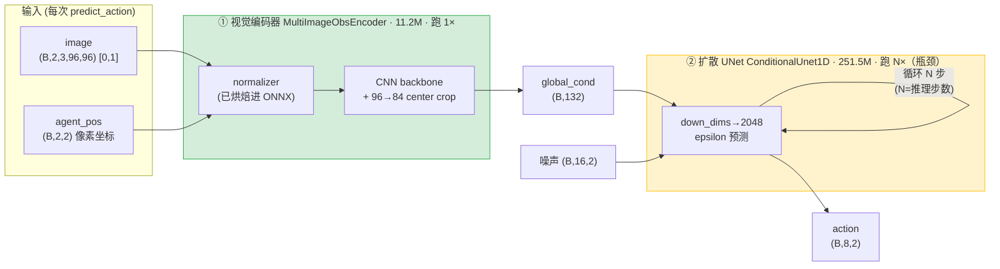

# 视觉扩散策略的压缩与边缘部署

> HomeBot-WM 主线实验报告 · 载体模型 = Diffusion Policy (image Push-T) · 目标 = Jetson AGX Orin
>
> 配套文档：[METHODOLOGY.md](METHODOLOGY.md)（来源/数据/校准/指标/命令）· [PROBLEMS.md](PROBLEMS.md)（踩坑记录）· [scripts/](scripts/)（全部脚本）

---

## 摘要

本项目将一个**视觉扩散策略**（Diffusion Policy 的 image Push-T 变体，262M 参数：251.5M 扩散 UNet + 11.2M 视觉编码器）在单张 **8GB RTX 3070** 上从头训练到 **87.6%**（DDPM-100，n=50），随后系统性地压缩、部署到 **Jetson AGX Orin** 并完成全墙钟实测。三个压缩杠杆**全部在 CPU 上完成量化验证**（压缩期间 3070 GPU 硬件故障，但 ONNX 导出 / INT8 PTQ / 闭环评测均不依赖 GPU），部署环最终在 Orin 上闭合：

1. **ONNX 导出**——拆成 `obs_encoder` + `unet` 两组件，FP32 数值 parity 达 **1.4×10⁻⁶**；
2. **INT8 静态量化（PTQ）**——onnxruntime QDQ 路线 n=50 下**精度无损**（FP32 0.738 / INT8 0.767–0.788，统计不可分），模型 960MB→241MB（~4×）；**但 Orin 上 TRT 原生熵校准 INT8 闭环掉 ~0.12（vs FP16，p<0.001，表 5）**——量化路线不同、代价不同；
3. **扩散步数压缩**——确认 **DDIM 是唯一可行的减步采样器**（DDPM 抽稀到 50 步即崩溃至 ~0.5，两种子复现），DDIM-50 精度甚至略超 DDPM-100。

**推荐部署配置（Orin 实测，速度↔精度权衡）**：INT8 提速 1.6×、模型 ~4× 小，但闭环掉 ~0.12（表 5，p<0.001）。**精度优先**用 DDIM-16 + FP16（83ms / 12Hz，已过 10Hz 环、精度更高）；**速度/内存优先**用 DDIM-16 + INT8（55ms / 18Hz，牺牲 ~0.12 精度换 1.6× 提速 + 4× 压缩）。表 4b「精度」列是 onnxruntime 口径，Orin TRT 闭环实测见表 5。部署环已闭合：TRT 引擎构建 + 全墙钟基准（表 4）+ 闭环精度对照（表 5）。

**诚实定位**：载体任务 Push-T 是 2D 玩具（非真机械臂），但压缩→部署的方法链与任务无关；所有精度数字为 pymunk 仿真闭环 `mean_score`（目标区覆盖率，0–1），非真机。Orin 延迟是**全墙钟实测**（ctypes 基准，非引擎级推算）——引擎级 cudaGraph 地板会更乐观（~10Hz@DDIM-50），但真实 Python 部署循环用不了 cudaGraph，实测 6.8Hz；这个口径差异已诚实纠正（见表 4 + PROBLEMS P15）。

---

## 核心结果

### 地图 1 · 模型结构与优化落点



**读法**：绿=已 INT8 量化（11MB）；黄=已 INT8 量化（241–278MB）且是**步数压缩的落点**（UNet 每次预测跑 N 次，N 从 100 砍到 50/5）。
**图例**：实线=数据流；自环=扩散去噪循环（N 步）。
**结果**：视觉编码器跑 1×、UNet 跑 N× → **延迟几乎全在 UNet×N**，故步数压缩是最大杠杆。
**分析**：`obs_as_global_cond=true`，观测编码成 132 维 global_cond 后，UNet 在其条件下对 16 步动作序列去噪。减 N 直接线性减延迟，且**不需重训**（`conditional_sample` 的循环由 `num_inference_steps` 参数化）。

**资源账**（实测，epoch-200 checkpoint）：

| 模块 | 参数量 | FP32 ONNX | INT8 ONNX | 每次预测调用次数 | 测于 |
|---|---|---|---|---|---|
| 视觉编码器 | 11.2M | 43 MB | 11 MB | 1× | §方法·导出 |
| 扩散 UNet | 251.5M | 960 MB | 241–278 MB | N×（N=推理步数） | §方法·导出 |
| **合计** | **262.7M** | **~1003 MB** | **~252–289 MB** | — | — |

INT8 相对 FP32 体积 ~3.5–4×；占 8GB 显存上限：FP32 训练时实测 7786/8192 MiB（95%）。

### 地图 2 · 实验逻辑链

```mermaid
flowchart TD
    Q1["Q1: 262M 视觉扩散模型<br/>能否在 8GB 训练?"] --> E1["E1: 从头训 image Push-T<br/>(§方法·训练)"]
    E1 --> R1["✓ epoch200=87.6%<br/>显存 95% 无 OOM"]
    R1 -->|"模型有了, 下一步压缩"| Q2["Q2: 能否导出 ONNX?"]
    Q2 --> E2["E2: 拆 encoder+unet 导出<br/>(§核心结果·ONNX)"]
    E2 --> R2["✓ parity 1.4e-6"]
    R2 -->|"导出成功, 量化它"| Q3["Q3: INT8 掉多少分?"]
    Q3 --> E3a["E3a: n=10 首测"]
    E3a --> R3a["✗ 看似掉 8 分<br/>(后被证伪)"]
    R3a -->|"n10 可疑, 加大样本"| E3b["E3b: n=50 复测<br/>(§核心结果·INT8)"]
    E3b --> R3b["✓ INT8 免费<br/>(0.738/0.767/0.788 不可分)"]
    R3b -->|"量化免费, 那步数呢"| Q4["Q4: 步数能减多少?"]
    Q4 --> E4["E4: DDIM 步数扫描 n=50<br/>(§核心结果·步数)"]
    E4 --> R4["DDIM 50→0.814<br/>16→0.738, 5→0.725"]
    R4 -->|"DDIM 行, 那 DDPM 呢"| Q5["Q5: DDPM 能减步吗?"]
    Q5 --> E5["E5: DDPM-50 两种子<br/>(§核心结果·采样器)"]
    E5 --> R5["✗ 崩到 0.49-0.56<br/>DDPM 不能减步"]
    R5 -->|"采样器定了, 上硬件"| Q6["Q6: TensorRT/Orin?"]
    Q6 --> E6["E6: TRT 原生 INT8 校准建引擎<br/>+ ctypes 全墙钟基准<br/>(§核心结果·表4)"]
    E6 --> R6["✓ Orin 全墙钟实测<br/>DDIM-16=18Hz, DDIM-50=6.8Hz"]
    R6 -->|"延迟有了, INT8 闭环掉分吗"| Q7["Q7: TRT INT8 闭环掉分吗?"]
    Q7 --> E7["E7: Orin 闭环 INT8 vs FP16<br/>6 噪声种子 × n=50<br/>(§核心结果·表5)"]
    E7 --> R7["✗ INT8 掉 0.12<br/>(p<0.001, 非混沌)"]

    style R3a fill:#f8d7da,stroke:#dc3545
    style R5 fill:#f8d7da,stroke:#dc3545
    style R7 fill:#f8d7da,stroke:#dc3545
    style R1 fill:#d4edda,stroke:#28a745
    style R2 fill:#d4edda,stroke:#28a745
    style R3b fill:#d4edda,stroke:#28a745
    style R6 fill:#d4edda,stroke:#28a745
```



**读法**：一行一轮，问题→实验(章节)→结论；红=被证否/失败分支，绿=通过。
**分析**：链条的主干是「训练→导出→量化→减步→部署」，E6 在 Orin 上闭合部署环、E7 进一步测闭环精度；E3a→E3b 是一次**自我纠错**（n=10 噪声推翻了 n=10 结论），E5 排除了 DDPM 减步这条岔路，E6 的墙钟基准纠正了「引擎级 cudaGraph 地板」的乐观估计（表 4 + PROBLEMS P15），E7 又纠正了「INT8 无损」的乐观假设——TRT 原生 INT8 闭环掉 0.12（表 5 + PROBLEMS P16）。

### 表 1 · 采样器 × 步数（FP32 ONNX，n=50，同 env/噪声种子）

| 采样器 | 推理步数 | mean_score | UNet 调用/预测 | 相对 DDPM-100 |
|---|---|---|---|---|
| DDPM | 100 | 0.787 | 100 | 基线 |
| DDPM | 50 | 0.558 / 0.490 † | 50 | −23 ~ −30 分（崩溃） |
| **DDIM** | **50** | **0.814** | **50** | **+2.7 分，2× 快** |
| DDIM | 16 | 0.738 | 16 | −4.9 分，6× 快 |
| DDIM | 5 | 0.725 | 5 | −6.2 分，20× 快 |

† 两个独立种子（seed=0 / seed=1），确认 DDPM 抽稀崩溃与种子无关。
**横轴**：推理步数（每次 predict_action 的 UNet 前向次数）。**竖轴**：Push-T 闭环 mean_score（目标区覆盖率 0–1，n=50 episodes）。
**结果**：DDPM 减步即崩（100→50 掉 23+ 分）；DDIM 减步优雅退化（50→5 仅掉 8.9 分），且 DDIM-50 反超 DDPM-100。
**分析**：DDPM 反向过程是逐步马尔可夫链，抽稀破坏其数学前提；DDIM 是 ODE 求解器，天生支持任意步数。**故步数压缩必须用 DDIM**。拐点：50→16 掉 7.6 分，16→5 只再掉 1.3 分 → 要压就别停在 16，直接到 5。

### 表 2 · INT8 量化精度（ddim16，n=50，同种子配对）

| 配置 | per_channel | 量化算子 | UNet INT8 体积 | mean_score | vs FP32 |
|---|---|---|---|---|---|
| FP32 | — | — | 960 MB | 0.738 | 基线 |
| INT8-A | 否 | 全部 | 241 MB | 0.788 | +5.0 分 |
| INT8-C | 是 | 仅 Conv | 278 MB | 0.767 | +2.9 分 |

**横轴**：量化配置。**竖轴**：mean_score（n=50，与 FP32 同 env/噪声种子，配对比较）。
**结果**：两个 INT8 配置都**不低于** FP32（甚至略高），三者落在同一噪声带内。
**分析**：INT8 PTQ 对该扩散策略**精度无损**——「量化掉分」在此不成立。INT8 略高于 FP32 是 n=50 配对噪声（±~0.04），不解读为「量化有益」，只解读为「无显著损失」。per_channel 与仅-Conv 两个杠杆在 n=10 时看似各救回几分，n=50 证明那是噪声（见 PROBLEMS P5）。

### 表 3 · 样本量教训（同配置 FP32 ddim16）

| n_test | mean_score | 说明 |
|---|---|---|
| 10 | 0.9497 | 噪声带 ±0.05，不可信 |
| 50 | 0.7379 | 可靠估计 |

**结果**：同一配置，n=10 与 n=50 差 **21 分**。
**分析**：Push-T 单 episode 覆盖率方差大，n=10 的均值噪声带达 ±0.05（Wilson）。**所有结论性数字一律用 n=50**；n=10 仅用于冒烟。这是本项目最重要的方法论教训（详见 PROBLEMS P5）。

### 表 4 · Orin 实测延迟（Jetson AGX Orin，TensorRT 10.7，batch=1）

部署环在 Orin（dog）上闭合：TRT 原生 INT8 校准（`IInt8EntropyCalibrator2`，128 真实观测）从 FP32 ONNX 建出 4 个引擎，再测延迟。**两个口径务必分清**——引擎级（trtexec 单引擎 GPU compute，不含编排）与全墙钟（`bench_predict_action.py`，ctypes 跑完整 `predict_action` = encoder×1 + unet×N + host 端 numpy DDIM 步进 + H2D/D2H）。

**表 4a · 单组件引擎级延迟（trtexec GPU compute，ms，--useCudaGraph + 200 iters）**

| 组件 | 角色 | FP16 | INT8 | INT8 vs FP16 |
|---|---|---|---|---|
| unet | 瓶颈，每次预测跑 ×N 步 | 3.52 | 1.96 | **快 1.79×** |
| obs_encoder | 每次预测跑 ×1 | 0.52 | 0.62 | 慢 0.85× |

不带 cudaGraph 的裸测：unet FP16 3.95 / INT8 2.43，encoder FP16 0.75 / INT8 0.86——结论一致（unet INT8 快 1.6×，encoder INT8 更慢）。

**表 4b · 全 predict_action 墙钟（median，warmup=5 iters=20；精度取自表 1，INT8 无损见表 2）**

| 配置 | DDIM 步数 | 精度 (n50) | 墙钟 (ms) | 吞吐 (Hz) | 过 10Hz |
|---|---|---|---|---|---|
| 全 FP16 | 50 | 0.814 | 238 | 4.2 | ✗ |
| 全 FP16 | 16 | 0.738 | 83 | 12.0 | ✓ |
| 全 FP16 | 5 | 0.725 | 31 | 31.8 | ✓ |
| **unet-INT8 + enc-FP16** | 50 | 0.814 | **147** | **6.8** | ✗ |
| **unet-INT8 + enc-FP16** | 16 | 0.738 | **55** | **18.2** | ✓ |
| **unet-INT8 + enc-FP16** | 5 | 0.725 | **30** | **33.5** | ✓ |

**横轴**：部署配置（精度 × DDIM 步数）。**竖轴**：全 `predict_action` 墙钟延迟（ms）与吞吐（Hz）；精度 = pymunk 闭环 mean_score（0–1，n=50）。
**结果**：INT8 端到端提速 DDIM-50 时 1.6×、DDIM-16 时 1.5×、DDIM-5 时 ~1.0×（低步数下收益消失——unet 只跑 5 次时固定开销主导）。**10Hz 控制环门槛只在 DDIM-16（18Hz）或 DDIM-5（33Hz）跨过；DDIM-50（精度最高 0.814）仅 6.8Hz、不过 10Hz。**
**分析**：
- **引擎级 ≠ 全墙钟（一次诚实纠错，详见 PROBLEMS P15）**：trtexec cudaGraph 引擎和（50×1.96+0.52≈98.5ms）会暗示 DDIM-50 可达 10.1Hz，但那是**不现实地板**——真实 Python DDIM 循环用不了 cudaGraph（host 端 numpy 步进打断图捕获），每步实际 ~2.65ms（plain exec 2.43 + Python 0.22），再加 ~21ms 编排开销（h2d/d2h/numpy/encoder），实测 147ms / 6.8Hz。账目经 diag 分解验证（引擎执行占 93%，编排占 7%）。
- **encoder INT8 反而更慢**（表 4a）：11M 小模型 + 大量 InstanceNorm 层被 TRT 自动回退 FP16，INT8↔FP16 reformat 开销盖过算力节省。但 encoder 只跑 ×1，端到端无差别（all-INT8 DDIM-50 = 142ms ≈ 混合 147ms）；按组件仍部署 FP16 encoder。
- **口径边界**：墙钟为 Python 部署循环（ctypes + libcudart，Orin 无 torch）；C++ 部署 + cudaGraph + 片上 DDIM 理论上可逼近引擎级地板（~10Hz@DDIM-50），但**未实现未测，不作声称**。dog GPU 与 system_agent 共享 → run 间方差 ±7%，故取 median、warmup≥5（冷启动曾虚高到 296ms，是假象非真实）。
- **表 4b 的「精度」列是 onnxruntime（表 1）口径，不是 Orin TRT 实测**——TRT 原生 INT8 在 Orin 闭环的真实精度更低，见表 5。

### 表 5 · Orin 闭环精度：TRT INT8 vs FP16（DDIM-50，n=50 episodes × 6 噪声种子，dog）

延迟（表 4）只回答「多快」；表 5 回答「INT8 在 Orin 闭环里掉不掉分」。用 `eval_trt_pusht.py`（ctypes，独立复刻 PushTImageEnv + MultiStepWrapper 的 obs 堆叠/动作执行/scoring）在 dog 上跑 FP16 与 TRT 原生 INT8 引擎的闭环，DDIM-50、n=50 episodes，跨 6 个独立 torch 噪声种子（seed 0–5）配对。

| 噪声 seed | FP16 | INT8 | INT8−FP16 |
|---|---|---|---|
| 0 | 0.625 | 0.495 | −0.130 |
| 1 | 0.600 | 0.548 | −0.052 |
| 2 | 0.568 | 0.422 | −0.146 |
| 3 | 0.611 | 0.441 | −0.170 |
| 4 | 0.637 | 0.504 | −0.133 |
| 5 | 0.616 | 0.525 | −0.091 |
| **均值** | **0.609** | **0.489** | **−0.120 ± 0.017 (SE)** |

**统计**：paired t = −6.97（df=5），**p < 0.001**；6/6 全负（sign test 单尾 p=0.016）；相对掉分 19.7%。
**结果**：**TRT 原生 INT8 在 Orin 闭环掉 ~0.12（vs FP16），是系统性真实损失，不是混沌噪声**（6 个独立噪声实现全负）。
**分析**：
- **与表 2 的对照（关键）**：表 2 的「INT8 无损」是 **onnxruntime QDQ INT8**（pc-3070 CPU）；这里是 **TRT 原生熵校准 INT8**（Orin）——两条 INT8 路线质量不同。parity 显示 TRT INT8 vs FP16 的 action 发散 ~7-9%（worst 20%），这个扰动在闭环里变成 ~0.12 的真实掉分。
- **混沌放大**：Push-T 闭环混沌 + 阈值性（coverage>0.95）使扰动不对称——把「本会成功」的轨迹踢出成功盆容易、反向难，故任何扰动都系统性降分。~0.12 是「INT8 量化误差 × 混沌放大」的乘积，高估了 INT8 内在质量损失，但它是 Orin 上真实的部署代价。
- **口径边界**：dog 绝对分（FP16 0.609）低于 pc-3070 基线（0.814），是平台差异（pymunk 7.3.1 vs 6.2.1）+ 混沌放大，**不能跨平台比绝对分**；但 INT8−FP16 是同平台（dog）配对，有效。

---

## 方法细节（可复现）

### 输入 / 输出（三个层次，务必分清）

**① 运行时系统**（部署后每个控制周期）：
- 输入：`image` 96×96 RGB（[0,1] float32）× 最近 2 帧（n_obs_steps=2）+ `agent_pos` 2D 像素坐标 × 2 帧
- 输出：未来 8 步动作（n_action_steps=8），每步 2D 力（action_dim=2）
- 数量账：观测编码成 132 维 global_cond（= 2 帧 × 66 维/帧）；UNet 对 16 步（horizon）动作序列去噪，取第 2–9 步执行

**② 构建流水线**（我们的工程）：
- 输入：训练好的 DP checkpoint（epoch-200）+ pusht 校准数据（128 样本）
- 输出：`obs_encoder.onnx` + `unet.onnx`（FP32）→ `*_int8.onnx`（QDQ INT8）→ TensorRT engine（Orin，待跑）

**③ 评测**：
- 输入：PushTImageEnv（pymunk 仿真）的 obs 流
- 输出：`mean_score`（T 形块对目标区的覆盖率，0–1），n=50 episodes

**不做什么**：不训练/微调载体模型之外的东西；不在真机上跑（纯仿真）；TensorRT 引擎不在 x86 上构建（不跨架构）。

### 方法总览

载体模型 = Diffusion Policy（[real-stanford/diffusion_policy](https://github.com/real-stanford/diffusion_policy)，MIT）的 image Push-T 变体，`TrainDiffusionUnetHybridWorkspace`。压缩链：

```
训练(8GB) → ONNX 导出(拆 encoder+unet) → INT8 PTQ(onnxruntime QDQ) → 步数压缩(DDIM) → TensorRT(Orin)
```

关键设计选择：
- **拆两组件导出**：扩散采样循环（UNet×N）留在 runtime，只导出 encoder 和 UNet 单步前向——这是扩散模型部署的标准做法，也让步数成为 runtime 旋钮。
- **normalizer 烘焙进 encoder ONNX**：导出图直接吃原始 obs（image [0,1] + agent_pos），动作反归一化留在 runtime。
- **INT8 用 QDQ ONNX**：onnxruntime 静态量化产出 QDQ 图，TensorRT 原生消费（无需单独校准缓存）。

### 方法细节

完整的模型/权重来源、数据集、校准集、指标定义、确切命令、环境版本见 **[METHODOLOGY.md](METHODOLOGY.md)**。全部踩坑（依赖地狱、GPU 故障、n10 噪声、DDPM 崩溃）见 **[PROBLEMS.md](PROBLEMS.md)**。

---

## 思考讨论

### 选型与结论

1. **INT8 量化不是免费的（一次纠正）**：onnxruntime QDQ 路线 n=50 下与 FP32 统计不可分（表 2）；但 **TRT 原生熵校准 INT8 在 Orin 闭环掉 ~0.12（vs FP16，p<0.001，表 5）**——两条 INT8 路线代价不同。INT8 仍给 1.6× 提速 + ~4× 压缩，但有真实精度代价，机理是 TRT INT8 的 action 发散（~7-9%）被 Push-T 混沌闭环放大。
2. **步数压缩必须走 DDIM**：DDPM 不能减步（抽稀即崩），DDIM 可以且优雅退化。步数直接决定 UNet 调用次数（DDPM-100 的 100× → DDIM-50 的 50× → DDIM-5 的 5×），Orin 墙钟随之近似线性变化（表 4b）。
3. **推荐部署配置（Orin 实测，速度↔精度权衡）**：**精度优先用 DDIM-16 + FP16**（83ms / 12Hz，已过 10Hz 环、精度更高）；**速度/内存优先用 DDIM-16 + INT8**（55ms / 18Hz，牺牲 ~0.12 精度换 1.6× 提速 + 4× 压缩）；极致低延迟用 DDIM-5（30ms / 33Hz）。encoder 部署用 FP16（INT8 反而更慢，表 4a）。注意 DDIM-50 + INT8（6.8Hz）不过 10Hz，INT8 提速在该档不帮助跨门槛。

### 反直觉发现（标注推断 vs 证明）

- **DDPM-50 崩溃**（0.49–0.56，两种子）：*证明*——DDPM 反向链被抽稀破坏。这是 DDIM 存在的理由，符合理论。
- **DDIM-50 > DDPM-100**（0.814 vs 0.787）：*观测到，机制为推断*——DDIM 确定性采样可能比 DDPM 随机采样在此任务上更稳定；未做严格消融，标注为合理推断。
- **INT8 略高于 FP32**：*噪声，非真实效应*——n=50 配对差 +5/+2.9 分在 ±0.04 噪声带内，只解读为「无损」。
- **encoder INT8 比 FP16 还慢**（表 4a，0.62 vs 0.52ms）：*证明（Orin 实测，裸测+cudaGraph 两法复测一致）*——encoder 仅 11M 且大量 InstanceNorm 层被 TRT 自动回退 FP16，INT8↔FP16 reformat 开销盖过 INT8 算力节省。**小模型 INT8 不一定快，要看层构成**；但 encoder 只跑 ×1，端到端无差别。
- **引擎级 cudaGraph 地板 ≠ 全墙钟**（表 4，DDIM-50 的 10.1Hz vs 6.8Hz）：*证明（实测 + diag 分解）*——trtexec cudaGraph 引擎和是理论地板，真实 Python DDIM 循环用不了 cudaGraph（host 端 numpy 步进打断图捕获），每步实际 ~2.65ms 而非 1.96ms，再加 ~21ms 编排。**教训：部署延迟必须测全墙钟，不能只看引擎级**（见 PROBLEMS P15）。
- **TRT 原生 INT8 闭环掉 0.12（vs FP16）**（表 5，6 种子全负，p<0.001）：*证明（Orin 闭环实测）*——与表 2 的 onnxruntime QDQ INT8「无损」相矛盾：两条 INT8 路线质量不同。机理是 TRT INT8 的 action 发散（~7-9%）被 Push-T 的**混沌闭环**放大——Push-T 对初始噪声实现极敏感（numpy 噪声 → ~0 分，torch 噪声 → 0.6），阈值 + 混沌使任何扰动都系统性降分。**教训：部署精度必须在目标硬件闭环实测，引擎级 parity 或 CPU 量化结果不能直接外推**（见 PROBLEMS P16）。

### 能用来干什么

方法链（ONNX 拆分导出 → QDQ INT8 → DDIM 减步 → TensorRT）与任务无关，可直接迁移到其他扩散策略 / 扩散世界模型的 Orin 部署。这正是 SD 压缩经验向机器人扩散模型的迁移。

### 诚实的边界

- **载体任务是 2D 玩具**（Push-T 质点推方块），非真机械臂。压缩方法可迁移，但「87.6%」不代表真实操作能力。
- **Orin 延迟与精度均已实测，但精度来自两条不同的 INT8 路径、代价不同**：延迟（表 4）测自 Orin 的 TensorRT 原生 INT8 校准引擎；表 1/2 的精度（0.814/0.738/0.725 与「INT8 无损」）测自 pc-3070 CPU 的 onnxruntime INT8 QDQ 闭环。**表 5 已补 Orin TRT 引擎闭环复测：TRT 原生 INT8 比 FP16 掉 ~0.12（p<0.001）**——两条 INT8 路线代价不同，onnxruntime 的「无损」不能直接外推到 TRT 原生 INT8。另外 dog 绝对分（FP16 0.609）低于 pc-3070 基线（0.814），是平台差异（pymunk 7.3.1 vs 6.2.1）+ 混沌放大，不能跨平台比绝对分。
- **墙钟是 Python 部署循环**（ctypes + libcudart，Orin 无 torch），含 host 端 numpy DDIM 步进 + H2D/D2H；C++ 部署 + cudaGraph + 片上 DDIM 会更快（理论逼近引擎级地板 ~10Hz@DDIM-50），但未实现未测，不作声称。dog GPU 与 system_agent 共享，run 间方差 ±7%，取 median。
- **ONNX DDPM-100（0.787）< 训练时 DDPM-100（0.876）**：跨 harness 差异（env 种子 n_envs 50 vs 56 + DDPM 随机性），非导出错误（FP32 parity 1.4e-6 已验证）。可靠比较是同 harness 内的 DDIM/DDPM 对照。
