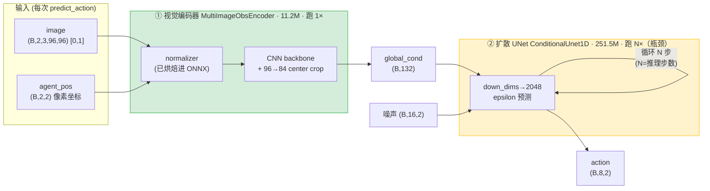

# 视觉扩散策略的压缩与边缘部署

> HomeBot-WM 主线实验报告 · 载体模型 = Diffusion Policy (image Push-T) · 目标 = Jetson AGX Orin
>
> 配套文档：[METHODOLOGY.md](METHODOLOGY.md)（来源/数据/校准/指标/命令）· [PROBLEMS.md](PROBLEMS.md)（踩坑记录）· [scripts/](scripts/)（全部脚本）

---

## 摘要

本项目将一个**视觉扩散策略**（Diffusion Policy 的 image Push-T 变体，262M 参数：251.5M 扩散 UNet + 11.2M 视觉编码器）在单张 **8GB RTX 3070** 上从头训练到 **87.6%**（DDPM-100，n=50），随后系统性地压缩并为 Jetson Orin 部署做准备。三个压缩杠杆**全部在 CPU 上完成量化验证**（实验期间 GPU 硬件故障，但 ONNX 导出 / INT8 PTQ / 闭环评测均不依赖 GPU）：

1. **ONNX 导出**——拆成 `obs_encoder` + `unet` 两组件，FP32 数值 parity 达 **1.4×10⁻⁶**；
2. **INT8 静态量化（PTQ）**——n=50 下**精度无损**（FP32 0.738 / INT8 0.767–0.788，统计不可分），模型 960MB→241MB（~4×）；
3. **扩散步数压缩**——确认 **DDIM 是唯一可行的减步采样器**（DDPM 抽稀到 50 步即崩溃至 ~0.5，两种子复现），DDIM-50 精度甚至略超 DDPM-100。

**推荐部署配置：DDIM-50 + INT8**——相对原始 DDPM-100 **提速 2× 且精度不降**（0.814 vs 0.787）；激进配置 **DDIM-5 + INT8 提速 20×、精度 −8 分**（0.725）。TensorRT 引擎构建脚本已就绪，待在 Orin 上实测延迟。

**诚实定位**：载体任务 Push-T 是 2D 玩具（非真机械臂），但压缩→部署的方法链与任务无关；所有精度数字为 pymunk 仿真闭环 `mean_score`（目标区覆盖率，0–1），非真机。TensorRT/Orin 实测尚未完成（GPU 故障 + 引擎不跨架构）。

---

## 核心结果

### 地图 1 · 模型结构与优化落点



**读法**：绿=已 INT8 量化（11MB）；黄=已 INT8 量化（241–278MB）且是**步数压缩的落点**（UNet 每次预测跑 N 次，N 从 100 砍到 50/5）。
**图例**：实线=数据流；自环=扩散去噪循环（N 步）。
**结果**：视觉编码器跑 1×、UNet 跑 N× → **延迟几乎全在 UNet×N**，故步数压缩是最大杠杆。
**分析**：`obs_as_global_cond=true`，观测编码成 132 维 global_cond 后，UNet 在其条件下对 16 步动作序列去噪。减 N 直接线性减延迟，且**不需重训**（`conditional_sample` 的循环由 `num_inference_steps` 参数化）。

**资源账**（实测，epoch-200 checkpoint）：

| 模块 | 参数量 | FP32 ONNX | INT8 ONNX | 每次预测调用次数 | 测于 |
|---|---|---|---|---|---|
| 视觉编码器 | 11.2M | 43 MB | 11 MB | 1× | §方法·导出 |
| 扩散 UNet | 251.5M | 960 MB | 241–278 MB | N×（N=推理步数） | §方法·导出 |
| **合计** | **262.7M** | **~1003 MB** | **~252–289 MB** | — | — |

INT8 相对 FP32 体积 ~3.5–4×；占 8GB 显存上限：FP32 训练时实测 7786/8192 MiB（95%）。

### 地图 2 · 实验逻辑链

```mermaid
flowchart TD
    Q1["Q1: 262M 视觉扩散模型<br/>能否在 8GB 训练?"] --> E1["E1: 从头训 image Push-T<br/>(§方法·训练)"]
    E1 --> R1["✓ epoch200=87.6%<br/>显存 95% 无 OOM"]
    R1 -->|"模型有了, 下一步压缩"| Q2["Q2: 能否导出 ONNX?"]
    Q2 --> E2["E2: 拆 encoder+unet 导出<br/>(§核心结果·ONNX)"]
    E2 --> R2["✓ parity 1.4e-6"]
    R2 -->|"导出成功, 量化它"| Q3["Q3: INT8 掉多少分?"]
    Q3 --> E3a["E3a: n=10 首测"]
    E3a --> R3a["✗ 看似掉 8 分<br/>(后被证伪)"]
    R3a -->|"n10 可疑, 加大样本"| E3b["E3b: n=50 复测<br/>(§核心结果·INT8)"]
    E3b --> R3b["✓ INT8 免费<br/>(0.738/0.767/0.788 不可分)"]
    R3b -->|"量化免费, 那步数呢"| Q4["Q4: 步数能减多少?"]
    Q4 --> E4["E4: DDIM 步数扫描 n=50<br/>(§核心结果·步数)"]
    E4 --> R4["DDIM 50→0.814<br/>16→0.738, 5→0.725"]
    R4 -->|"DDIM 行, 那 DDPM 呢"| Q5["Q5: DDPM 能减步吗?"]
    Q5 --> E5["E5: DDPM-50 两种子<br/>(§核心结果·采样器)"]
    E5 --> R5["✗ 崩到 0.49-0.56<br/>DDPM 不能减步"]
    R5 -->|"采样器定了, 上硬件"| Q6["Q6: TensorRT/Orin?"]
    Q6 --> E6["E6: build_trt.py 就绪"]
    E6 --> R6["⏳ 待 Orin 实测<br/>(GPU 故障+引擎不跨架构)"]

    style R3a fill:#f8d7da,stroke:#dc3545
    style R5 fill:#f8d7da,stroke:#dc3545
    style R6 fill:#d1ecf1,stroke:#17a2b8
    style R1 fill:#d4edda,stroke:#28a745
    style R2 fill:#d4edda,stroke:#28a745
    style R3b fill:#d4edda,stroke:#28a745
```



**读法**：一行一轮，问题→实验(章节)→结论；红=被证否/失败分支，绿=通过，蓝=待硬件。
**分析**：链条的主干是「训练→导出→量化→减步→部署」；E3a→E3b 是一次**自我纠错**（n=10 噪声推翻了 n=10 结论），E5 排除了 DDPM 减步这条岔路。

### 表 1 · 采样器 × 步数（FP32 ONNX，n=50，同 env/噪声种子）

| 采样器 | 推理步数 | mean_score | UNet 调用/预测 | 相对 DDPM-100 |
|---|---|---|---|---|
| DDPM | 100 | 0.787 | 100 | 基线 |
| DDPM | 50 | 0.558 / 0.490 † | 50 | −23 ~ −30 分（崩溃） |
| **DDIM** | **50** | **0.814** | **50** | **+2.7 分，2× 快** |
| DDIM | 16 | 0.738 | 16 | −4.9 分，6× 快 |
| DDIM | 5 | 0.725 | 5 | −6.2 分，20× 快 |

† 两个独立种子（seed=0 / seed=1），确认 DDPM 抽稀崩溃与种子无关。
**横轴**：推理步数（每次 predict_action 的 UNet 前向次数）。**竖轴**：Push-T 闭环 mean_score（目标区覆盖率 0–1，n=50 episodes）。
**结果**：DDPM 减步即崩（100→50 掉 23+ 分）；DDIM 减步优雅退化（50→5 仅掉 8.9 分），且 DDIM-50 反超 DDPM-100。
**分析**：DDPM 反向过程是逐步马尔可夫链，抽稀破坏其数学前提；DDIM 是 ODE 求解器，天生支持任意步数。**故步数压缩必须用 DDIM**。拐点：50→16 掉 7.6 分，16→5 只再掉 1.3 分 → 要压就别停在 16，直接到 5。

### 表 2 · INT8 量化精度（ddim16，n=50，同种子配对）

| 配置 | per_channel | 量化算子 | UNet INT8 体积 | mean_score | vs FP32 |
|---|---|---|---|---|---|
| FP32 | — | — | 960 MB | 0.738 | 基线 |
| INT8-A | 否 | 全部 | 241 MB | 0.788 | +5.0 分 |
| INT8-C | 是 | 仅 Conv | 278 MB | 0.767 | +2.9 分 |

**横轴**：量化配置。**竖轴**：mean_score（n=50，与 FP32 同 env/噪声种子，配对比较）。
**结果**：两个 INT8 配置都**不低于** FP32（甚至略高），三者落在同一噪声带内。
**分析**：INT8 PTQ 对该扩散策略**精度无损**——「量化掉分」在此不成立。INT8 略高于 FP32 是 n=50 配对噪声（±~0.04），不解读为「量化有益」，只解读为「无显著损失」。per_channel 与仅-Conv 两个杠杆在 n=10 时看似各救回几分，n=50 证明那是噪声（见 PROBLEMS P5）。

### 表 3 · 样本量教训（同配置 FP32 ddim16）

| n_test | mean_score | 说明 |
|---|---|---|
| 10 | 0.9497 | 噪声带 ±0.05，不可信 |
| 50 | 0.7379 | 可靠估计 |

**结果**：同一配置，n=10 与 n=50 差 **21 分**。
**分析**：Push-T 单 episode 覆盖率方差大，n=10 的均值噪声带达 ±0.05（Wilson）。**所有结论性数字一律用 n=50**；n=10 仅用于冒烟。这是本项目最重要的方法论教训（详见 PROBLEMS P5）。

---

## 方法细节（可复现）

### 输入 / 输出（三个层次，务必分清）

**① 运行时系统**（部署后每个控制周期）：
- 输入：`image` 96×96 RGB（[0,1] float32）× 最近 2 帧（n_obs_steps=2）+ `agent_pos` 2D 像素坐标 × 2 帧
- 输出：未来 8 步动作（n_action_steps=8），每步 2D 力（action_dim=2）
- 数量账：观测编码成 132 维 global_cond（= 2 帧 × 66 维/帧）；UNet 对 16 步（horizon）动作序列去噪，取第 2–9 步执行

**② 构建流水线**（我们的工程）：
- 输入：训练好的 DP checkpoint（epoch-200）+ pusht 校准数据（128 样本）
- 输出：`obs_encoder.onnx` + `unet.onnx`（FP32）→ `*_int8.onnx`（QDQ INT8）→ TensorRT engine（Orin，待跑）

**③ 评测**：
- 输入：PushTImageEnv（pymunk 仿真）的 obs 流
- 输出：`mean_score`（T 形块对目标区的覆盖率，0–1），n=50 episodes

**不做什么**：不训练/微调载体模型之外的东西；不在真机上跑（纯仿真）；TensorRT 引擎不在 x86 上构建（不跨架构）。

### 方法总览

载体模型 = Diffusion Policy（[real-stanford/diffusion_policy](https://github.com/real-stanford/diffusion_policy)，MIT）的 image Push-T 变体，`TrainDiffusionUnetHybridWorkspace`。压缩链：

```
训练(8GB) → ONNX 导出(拆 encoder+unet) → INT8 PTQ(onnxruntime QDQ) → 步数压缩(DDIM) → TensorRT(Orin)
```

关键设计选择：
- **拆两组件导出**：扩散采样循环（UNet×N）留在 runtime，只导出 encoder 和 UNet 单步前向——这是扩散模型部署的标准做法，也让步数成为 runtime 旋钮。
- **normalizer 烘焙进 encoder ONNX**：导出图直接吃原始 obs（image [0,1] + agent_pos），动作反归一化留在 runtime。
- **INT8 用 QDQ ONNX**：onnxruntime 静态量化产出 QDQ 图，TensorRT 原生消费（无需单独校准缓存）。

### 方法细节

完整的模型/权重来源、数据集、校准集、指标定义、确切命令、环境版本见 **[METHODOLOGY.md](METHODOLOGY.md)**。全部踩坑（依赖地狱、GPU 故障、n10 噪声、DDPM 崩溃）见 **[PROBLEMS.md](PROBLEMS.md)**。

---

## 思考讨论

### 选型与结论

1. **INT8 量化是免费的**：对该扩散策略，INT8 PTQ（per_tensor 或 per_channel）在 n=50 下与 FP32 统计不可分。这意味着 Orin 上可以直接用 INT8 拿 ~4× 体积压缩 + 加速，无需担心精度。
2. **步数压缩必须走 DDIM**：DDPM 不能减步（抽稀即崩），DDIM 可以且优雅退化。DDIM-50 是甜点位（2× 加速、精度甚至略升）；DDIM-5 是极致（20× 加速、−8 分）。
3. **推荐部署配置**：DDIM-50 + INT8（平衡）或 DDIM-5 + INT8（极致延迟）。

### 反直觉发现（标注推断 vs 证明）

- **DDPM-50 崩溃**（0.49–0.56，两种子）：*证明*——DDPM 反向链被抽稀破坏。这是 DDIM 存在的理由，符合理论。
- **DDIM-50 > DDPM-100**（0.814 vs 0.787）：*观测到，机制为推断*——DDIM 确定性采样可能比 DDPM 随机采样在此任务上更稳定；未做严格消融，标注为合理推断。
- **INT8 略高于 FP32**：*噪声，非真实效应*——n=50 配对差 +5/+2.9 分在 ±0.04 噪声带内，只解读为「无损」。

### 能用来干什么

方法链（ONNX 拆分导出 → QDQ INT8 → DDIM 减步 → TensorRT）与任务无关，可直接迁移到其他扩散策略 / 扩散世界模型的 Orin 部署。这正是 SD 压缩经验向机器人扩散模型的迁移。

### 诚实的边界

- **载体任务是 2D 玩具**（Push-T 质点推方块），非真机械臂。压缩方法可迁移，但「87.6%」不代表真实操作能力。
- **TensorRT/Orin 未实测**：引擎不跨架构，必须在 Orin 上构建；GPU 故障期间所有工作在 CPU 完成。Orin 延迟是最终交付的最后一环，尚未拿到。
- **ONNX DDPM-100（0.787）< 训练时 DDPM-100（0.876）**：跨 harness 差异（env 种子 n_envs 50 vs 56 + DDPM 随机性），非导出错误（FP32 parity 1.4e-6 已验证）。可靠比较是同 harness 内的 DDIM/DDPM 对照。
- **INT8 是 onnxruntime CPU 量化**，非 TensorRT INT8；TensorRT 原生支持 per-channel，预期行为类似，但终值待 Orin 验证。
